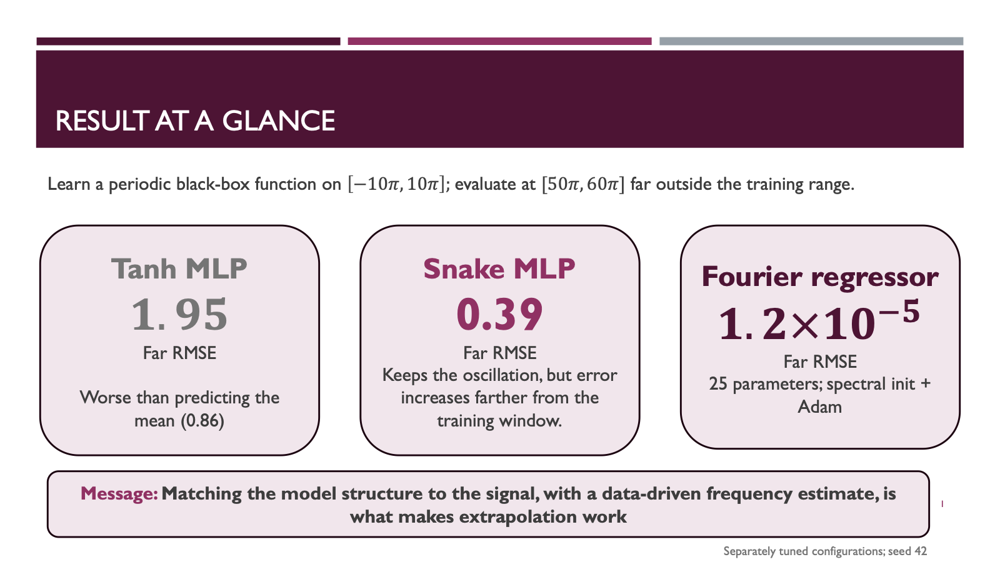

# Andromeda: function approximation and extrapolation

A reproducible PyTorch benchmark comparing a Tanh MLP, a trainable Snake MLP,
and a learnable Fourier regressor on one noise-free periodic function. Models
learn from sampled `(x, y)` pairs. The reference function generates labels and
evaluation curves; saved-model inference never calls it.

The central question is whether a model that interpolates accurately also
continues the waveform beyond the observed interval.

## Quickstart

Run these commands in a terminal. You need Git and
[`uv`](https://docs.astral.sh/uv/) installed. `uv` manages Python and the project
dependencies; you do not need to install Python separately. The project pins
Python 3.11 in `.python-version` and runs on CPU by default.

On Windows, use **PowerShell**. Unless a block is labeled for a specific OS,
the commands work in macOS/Linux terminals and Windows PowerShell. Paths with
forward slashes also work on Windows. All commands run from the repository root.

### 1. Install uv (once per laptop)

If `uv --version` already works, skip this step. On macOS or Linux:

```bash
curl -LsSf https://astral.sh/uv/install.sh | sh
```

On Windows PowerShell:

```powershell
powershell -ExecutionPolicy ByPass -c "irm https://astral.sh/uv/install.ps1 | iex"
```

Restart your terminal after installation, then check:

```bash
uv --version
```

For other installation options, see the
[uv installation guide](https://docs.astral.sh/uv/getting-started/installation/).

### 2. Clone the repository and install dependencies

```bash
git clone https://github.com/ankitkr8540/Andromeda-TakeHome.git
cd Andromeda-TakeHome
uv sync --locked
```

If you already have the repository, open a terminal in its root directory and
run only `uv sync --locked`. This downloads Python 3.11 if needed, creates the
local `.venv` environment, and installs the locked dependencies, including test
and lint tools. The first installation needs internet access.

You do **not** need to run `uv venv` or activate the environment separately.
Every `uv run` command below uses the project's environment automatically.
Run all commands from the repository root.

### 3. Check the installation

macOS/Linux:

```bash
MPLBACKEND=Agg uv run python -m pytest -q
```

Windows PowerShell:

```powershell
$env:MPLBACKEND = "Agg"
uv run python -m pytest -q
```

This runs the test suite without opening plot windows.

### 4. Train your first model

```bash
uv run python -m scripts.run_experiments --config configs/experiments/fourier_rich_periodic.yaml
```

This trains the Fourier model and saves a new run under
`outputs/fourier/rich_periodic/`. The command prints the completed run's path.
Open its `plots/extrapolation.png` to inspect predictions, or read
`metrics/metrics.json` for scores. Training can take time on CPU; the full
ablation studies below run multiple experiments and take longer.

No GPU, Docker, or MLflow server is required for the default workflow.

## Presentation

The take-home presentation summarizes the methodology, ablation studies,
interpolation and extrapolation results, and limitations.

- [Presentation PDF](takehome.pdf)

## Results at a glance

[](takehome.pdf)

Click the slide to open the full presentation.

**10,000 in-domain points (7,000 train / 1,000 validation / 2,000 test), seed 42,
one noise-free periodic target.** Near and far bands contain 2,000 evaluation
points each. Checkpoints are selected using validation MSE; test and extrapolation
scores are reporting only. Scores use the current disjoint test grid.

| Model                             | Interpolation RMSE |     Near RMSE |      Far RMSE |
| --------------------------------- | -----------------: | ------------: | ------------: |
| Selected Tanh MLP, LR 0.0001      |            0.03640 |       1.60579 |       1.94616 |
| Tuned raw-input Snake MLP         |           0.005507 |       0.12203 |       0.38740 |
| **Fourier: spectral + Adam, K=8** |      **1.55×10⁻⁶** | **3.37×10⁻⁶** | **1.22×10⁻⁵** |

Tanh and Snake use separately tuned recipes, so this is not an activation-only
comparison. Fourier was the most accurate of these evaluated models on this
benchmark. A full local reproduction verified 33 saved runs through checkpoint
reloads, exported predictions, and recomputed metrics; outputs are generated
locally and are not included in a fresh clone.

With **1,000 in-domain points (700 / 100 / 200)**, spectral + Adam K=8 also won
on validation RMSE among the seven tested configurations, with interpolation /
near / far RMSE of **3.16×10⁻⁶ / 7.02×10⁻⁶ / 2.84×10⁻⁵**. That check retained
the existing recipes and epoch limits; it did not retune the models or match
optimizer-update counts across sample budgets. Both results concern one seed
and one target, rather than general extrapolation guarantees.

## Repository structure

```text
function_approximation/
├── data/             # reference labels, deterministic grids, datasets, preprocessing
├── models/           # Tanh MLP, Snake MLP, Fourier regressor, model construction
├── training/         # config loading/validation, optimization, checkpoints, tracking
├── evaluation/       # metrics and shared presentation-style plots
└── inference.py      # prediction from a saved run without reference labels
configs/
├── base.yaml         # shared training, preprocessing, evaluation, tracking defaults
├── data/             # target, sample count, observed domain, evaluation bands
├── model/            # model-specific defaults
├── experiments/      # standalone MLP, Snake, and Fourier recipes
├── best/             # selected recipes for all three models
└── ablations/
    ├── mlp/          # architecture, activation, learning rate, batch size
    ├── snake/        # controlled Tanh versus Snake comparison
    └── fourier/      # initialization, capacity, random-start tuning, multiple seeds
scripts/              # experiment/study runners and distance evaluation
docs/                 # folder structure and Python API sources (Sphinx)
notebooks/            # end-to-end Fourier walkthrough
tests/                # automated tests
```

YAML includes resolve relative to the including file. Files merge in listed
order, followed by local overrides. Mappings merge recursively; lists replace.
Relative `experiment.output_dir` paths are anchored to the repository root,
which is detected from the runner's location, rather than your username or
current working directory. The supplied configs need no path edits after cloning.
Generated study and notebook configs also use repository-relative output paths
for destinations inside the project. Explicit absolute destinations outside the
project remain supported.

Every run saves its resolved configuration. Configuration validation happens
before the experiment runner creates a run directory.

## Data and evaluation protocol

The reference `rich_periodic` is defined in
[`dataset.py`](function_approximation/data/dataset.py):

```text
f(x) = sin(x) + 0.55 cos(2x) + 0.35 sin(3x + 0.4)
       + 0.20 cos(5x - 0.7) + 0.12 sin(7x) + 0.08 cos(11x + 0.2)
```

| Split                       | Inputs                            | Samples |
| --------------------------- | --------------------------------- | ------: |
| Training                    | [−10π, 10π], including boundaries |   7,000 |
| Validation                  | Interior of the same interval     |   1,000 |
| Held-out interpolation test | Interior of the same interval     |   2,000 |
| Near extrapolation          | (10π, 20π]                        |   2,000 |
| Far extrapolation           | (50π, 60π]                        |   2,000 |

All grids are deterministic. Validation and test use different interior cell
offsets, adjusted when necessary to remain disjoint after float32 conversion
for both raw and standardized inputs. `data.sample_size` controls the in-domain
70%/10%/20% split; evaluation-band sample counts are separate.

StandardScaler, when enabled, fits training inputs only. Training minimizes
MSE with Adam; checkpoint selection and early stopping use validation MSE.
`min_delta` is in **MSE units**. Test and extrapolation labels are used only for
evaluation. Metrics include MSE, RMSE, MAE, and R² in original target units,
plus a baseline that predicts the training-label mean.

## End-to-end notebook

Open [`notebooks/fourier_end_to_end.ipynb`](notebooks/fourier_end_to_end.ipynb)
and select the repository's `.venv/bin/python` kernel on macOS/Linux or
`.venv/Scripts/python.exe` on Windows. Run cells in order to
generate 1,000 in-domain samples, inspect spectral initialization, train with
Adam, view metrics/plots, and reload the saved checkpoint for inference.
Change `SAMPLE_SIZE` in the notebook to use another budget. Each execution saves
a fresh run under `outputs/notebooks/fourier/`; it does not overwrite the study
results. A notebook interface and `ipykernel` are optional environment tools,
not runtime requirements of the training package.

## Train the selected models

The three configs in `configs/best/` reproduce the selected training recipes
reported above for the 10,000-point, seed-42 benchmark. Each includes the
corresponding standalone experiment and applies the selected overrides.

| Config | Selected recipe |
| ------ | --------------- |
| [`mlp_rich_periodic.yaml`](configs/best/mlp_rich_periodic.yaml) | Tanh [64, 256, 128], standardized inputs, Adam LR 0.0001 |
| [`snake_rich_periodic.yaml`](configs/best/snake_rich_periodic.yaml) | Snake [64, 256, 128], raw inputs, LR 0.001 for weights and activation parameters, batch 128 |
| [`fourier_rich_periodic.yaml`](configs/best/fourier_rich_periodic.yaml) | K=8, raw inputs, spectral initialization followed by Adam |

Run all three commands below from the repository root to generate the selected
Tanh MLP, Snake MLP, and Fourier checkpoints. You can also run just one model:

```bash
uv run python -m scripts.run_experiments --config configs/best/mlp_rich_periodic.yaml
uv run python -m scripts.run_experiments --config configs/best/snake_rich_periodic.yaml
uv run python -m scripts.run_experiments --config configs/best/fourier_rich_periodic.yaml
```

Each command trains a fresh model and saves a timestamped run under
`outputs/best/<model>/rich_periodic/`, including its validation-selected
`model/best_model.pt`, resolved config, metrics, and plots. These YAML files
contain training settings; trained weights are generated locally.

“Best” refers to the selected recipes among the configurations evaluated for
this target and sample budget. It does not guarantee the best result for other
functions, seeds, or datasets. Exact scores may vary across environments.

Snake learns one positive activation scale per hidden neuron using
`Snake(z) = z + sin²(a z) / a`. The selected recipe uses LR 0.001 for both
network weights and activation parameters.

Fourier predictions are a bias plus K weighted sine/cosine pairs (3K+1
parameters). Spectral initialization scores candidate frequencies on training
residuals, refines selected candidates locally, and refits the coefficients.
Adam then jointly updates frequencies, coefficients, and bias.

The configured angular-frequency search and random-initialization interval is
**[0.1, 20] radians per model-input unit**, identical for the matched random and
spectral arms. It is an explicit bandwidth prior, not a bound derived
by the code from Nyquist or an automatically inferred target period. Adam does
not constrain learned frequencies to that interval. No exact target frequencies
are supplied to the fitting procedure.

To reproduce the ablation and multi-seed experiments, see the
[study reproduction guide](docs/reproduce_studies.md). These optional studies
run multiple training jobs and can take substantial CPU time.

## Read the outputs

Individual training runs create a new UTC-timestamped directory beneath their configured
`experiment.output_dir`. The runner prints the run path on completion:

```text
<run>/
├── config.yaml
├── model/
│   ├── best_model.pt            # validation-selected checkpoint
│   └── preprocessor.joblib      # fitted preprocessing, including identity mode
├── data/
│   └── predictions.npz          # original inputs, labels, predictions by split
├── metrics/
│   ├── metrics.json
│   └── baseline_metrics.json
├── diagnostics/
│   ├── history.json             # MSE history
│   ├── timing.json
│   ├── initialization.json      # Fourier only
│   └── spectrum.json            # Fourier only
└── plots/
    ├── predictions.png
    ├── residuals.png
    ├── learning_curves.png
    └── extrapolation.png
```

Plots and prediction exports are configurable. Spectral-only runs omit learning
curves because they do not perform gradient updates. Curve plots use π axis
labels, gray reference curves, and magenta predictions.

Replace `RUN_DIR` below with the printed timestamped run directory:

```bash
uv run python -m json.tool RUN_DIR/metrics/metrics.json
```

Open the plot on macOS:

```bash
open "RUN_DIR/plots/extrapolation.png"
```

Windows PowerShell:

```powershell
Start-Process "RUN_DIR/plots/extrapolation.png"
```

On Linux:

```bash
xdg-open "RUN_DIR/plots/extrapolation.png"
```

Study roots contain `configs/`, `results/`, `logs/`, and `runs/`, plus
`metrics.csv`, `progress.json`, `selected_models.json`, and comparison plots.
Their nested runs follow the same artifact layout. Outputs are ignored by Git;
a fresh clone must generate its own checkpoints.

## Inference from a saved run

After training with the configs in `configs/best/`, use the commands below to
load each model's saved best-validation checkpoint. Replace `RUN_TIMESTAMP`
in each path with that model's timestamped run folder, printed at the end of
training. Each model can have a different timestamp.

```bash
# Selected Tanh MLP
uv run python -m function_approximation.inference --run-dir outputs/best/mlp/rich_periodic/RUN_TIMESTAMP --x -3.14 0 100

# Selected Snake MLP
uv run python -m function_approximation.inference --run-dir outputs/best/snake/rich_periodic/RUN_TIMESTAMP --x -3.14 0 100

# Selected Fourier model
uv run python -m function_approximation.inference --run-dir outputs/best/fourier/rich_periodic/RUN_TIMESTAMP --x -3.14 0 100
```

Replace the numbers after `--x` with your input values. These commands perform
inference only; each run must already contain both `model/best_model.pt` and
`model/preprocessor.joblib`. If a model has not finished training, first run
its command in [Train the selected models](#train-the-selected-models).

Pass the **run root**, not its `model/` subdirectory. The CLI loads the checkpoint
and matching preprocessor, accepts original unscaled inputs, and returns JSON
predictions. It also supports legacy flat run directories. No training data,
labels, or reference-function calls are needed. Extrapolation is permitted but
accuracy outside the observed interval is not guaranteed.

### Understanding the inputs and outputs

`--x -3.14 0 100` requests three predictions, one for each input, in that order.
These are example values; replace them with your own space-separated numbers.
Inputs are in original units: do not standardize them yourself.

The training interval is [−10π, 10π], approximately [−31.42, 31.42]. Inputs
−3.14 and 0 test interpolation; 100 tests extrapolation. The JSON output contains
`x` and `predictions` arrays with matching positions. The CLI returns model
predictions only. Use the UI below to compare them with reference outputs.

### Compare inputs in a simple UI

The UI is implemented in [`streamlit_app.py`](streamlit_app.py). Train all three
selected models to make each available in the dropdown, then launch it (a single
completed model is enough to try the UI):

```bash
uv sync --locked --group ui
uv run --group ui streamlit run streamlit_app.py
```

Open the local URL printed in the terminal (usually `http://localhost:8501`).

1. Choose one saved model from the dropdown. Only runs under `outputs/best/`
   with both a checkpoint and saved preprocessor appear.
2. Choose **Enter numbers** for values separated by commas, spaces, or newlines
   (for example, `-3.14, 0, 100`), or **Generate a range** and set the start, end,
   and number of points (2–10,000). Range inputs are evenly spaced and include
   both endpoints; the start must be less than the end.
3. Choose **Table** or **Plot**, then click **Compare**.

The table shows each input, reference output, predicted output, and absolute
error. The plot shows reference and predicted points for manual inputs, or curves
connecting the generated points for a range.
To capture comparisons for all three models, repeat these steps for Tanh MLP,
Snake MLP, and Fourier using the same inputs. Click **Download comparison CSV**
after each comparison and save a separate file for each model. For a visual
record, select **Plot** and take a screenshot of each result. The UI displays
one model at a time. No model is trained in the UI.
The reference function is evaluated separately for comparison; model predictions
still come exclusively from the saved checkpoint and preprocessor.

## Interpretation and limitations

Spectral + Adam with K=8 achieved the lowest validation RMSE among the tested
Fourier configurations. K=4 had higher approximation error, while K=16 provided
no improvement and had worse far extrapolation.

The tuned Snake comparison changes preprocessing and training settings as well
as activation. Use the controlled activation study to assess the activation
change alone.

Results concern one noise-free periodic target. Extrapolation error increases
with distance, and performance on noisy or non-periodic functions remains
untested. Exact scores may vary across environments.

## Tests and checks

macOS/Linux:

```bash
MPLBACKEND=Agg uv run python -m pytest -q
```

Windows PowerShell:

```powershell
$env:MPLBACKEND = "Agg"
uv run python -m pytest -q
```

Check application code, scripts, the UI, and tests for lint errors (all platforms):

```bash
uv run ruff check function_approximation scripts tests streamlit_app.py
```

The latest full preflight passed **321 tests across 21 test files**. Coverage
includes disjoint data grids, train-only preprocessing, config validation,
model construction, initialization, training safety, checkpoint restoration,
inference without target calls, metrics, visualization, study runners, and
MLflow artifact logging. The latest full run passed without warnings, with
SQLAlchemy deprecations treated as errors. The count describes that verification
snapshot.

## Optional: build the documentation

The Sphinx documentation contains the **study reproduction guide, folder
structure, and Python API**.
API pages are generated from the implementation's docstrings. Documentation
sources live in `docs/`; generated HTML under `docs/_build/` is ignored by Git.

Install the optional documentation dependencies and build from the repository root:

```bash
# Install the locked project dependencies, including documentation tools
uv sync --locked --inexact --group docs

# Build HTML documentation; report all warnings and fail if any occur
uv run --group docs sphinx-build -W --keep-going -b html docs docs/_build/html
```

Open `docs/_build/html/index.html` in your browser. On macOS:

```bash
open docs/_build/html/index.html
```

Windows PowerShell:

```powershell
Start-Process "docs/_build/html/index.html"
```

On Linux:

```bash
xdg-open docs/_build/html/index.html
```

Rebuild after changing Python docstrings or documentation sources. The build
treats warnings as errors. Documentation dependencies are optional for training
and inference; generated HTML does not need to be committed.

## Optional MLflow tracking

Set `tracking.enabled: true` in YAML and start a local server separately:

```bash
uv run mlflow server --backend-store-uri sqlite:///mlflow.db --artifacts-destination ./mlartifacts --host 127.0.0.1 --port 5001
```

The default tracking URI is `http://127.0.0.1:5001`. Runs log parameters,
training metrics, and enabled artifacts. Local outputs are saved whether or
not tracking is enabled.
